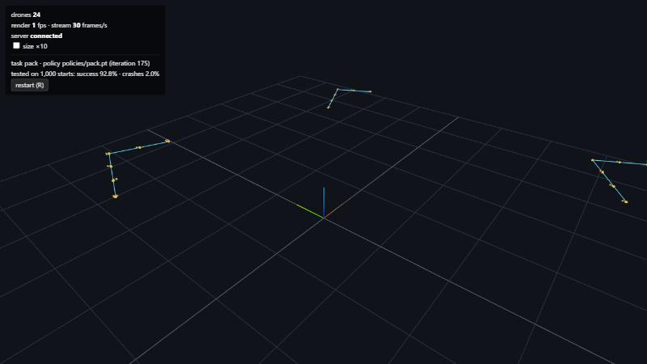

# MindFlight 🛸🧠

Thousands of simulated drones learning to fly at once, on one GPU, and you can watch every brain learn live in your
browser!



I wanted to know what every number in there was doing, so I wrote the drone physics myself in PyTorch from the
published numbers for a real Crazyflie 2.x. The learning is PPO, which I wrote as one file so you can read it top to
bottom.

## Try it

1. `pip install -e .[dev]` (Python 3.11+, PyTorch, and an NVIDIA GPU helps a lot)
2. `python -m mindflight.hub`
3. Your browser opens, so pick a show from the sidebar and watch!

On Windows you can just double-click `MindFlight Hub.bat`.

## How it works

- **Physics:** every drone is one row of one big tensor, so 16,384 of them step together on the GPU. Rotation uses
  RK4 so a tumbling drone doesn't gain energy it never had.
- **Motors and controller:** motors lag like real ones, and the brain sends thrust, roll, pitch and yaw rate, the same
  kind of command a real Crazyflie takes over the radio.
- **Sensors:** the brain never sees the true state. It gets noisy estimates that are a little late, like a real
  drone's.
- **Real-world drones:** every training flight is a slightly different drone (mass, motors, battery, wind), so the
  brain can't cheat on one perfect model.
- **Learning:** PPO in one readable file, with a curriculum that makes each task harder as the brain gets better.
- **Viewer:** three.js in the browser, streamed live from Python.

See [PLAN.md](PLAN.md) for how it all fits together and [CONTRIBUTING.md](CONTRIBUTING.md) if you want to help out.

## What went wrong (and how I fixed it)

- **Every drone timed out on the same step.** All 4,096 hit their time limit together, the value loss spiked on that
  beat and the waypoint brain fell apart. Now each drone starts at a random point in its episode.
- **Perfect-looking sensor noise broke hover.** I drew fresh noise every 20 ms and the flow-deck hover stalled at
  about 80%, because the brain chased jitter a real filter would never produce. The noise now wanders smoothly, like
  a real estimator's.
- **A strong pull home made a lazy guard.** In the ball-blocking task, a big reward for staying at its spot taught the
  drone to never leave it. A gentle pull fixed it.
- **It only knew one kind of throw.** A brain trained on medium throws chased high lobs straight into the person's
  safety zone. Mixing fast throws and lobs in training fixed it.

## Results

All seven levels are done. Every score is from 1,000 fixed test flights with the brain's mean action, on the hardest setting:

| Level | Done when | Result |
|---|---|---|
| 0 Physics | tests prove free fall, hover, torque signs, unit quaternions; 4,096 drones on the GPU | 567 M drone-steps/s at 16,384 drones (CUDA graph + compile) |
| 1 Hover | holds 1 m for 10 s from random starts | 100.0 %, 0 crashes |
| 2 Fly to a point | ≥ 95 % of targets reached within 10 cm, settled | 99.3 % |
| 3 Gates | ≥ 90 % finish 6 gates in order | 95.8 %, 3.7 s laps |
| 4 Obstacles | ≥ 90 % cross the densest pillar field by lidar | 100.0 % (99.6 % on 2,000 more) |
| 5 Sturdy | survives gusts and ±20 % mass; beats the non-randomized policy | 97.4 % vs 84.6 % (77.8 % vs 56.0 % in 2× wind) |
| 6 Race | ≥ 3 policies race live with a leaderboard | racer won 96 of 100 rounds (3.36 s laps vs 3.68 s) |

## The Hub: everything in one page

Double-click **`MindFlight Hub.bat`**, or run:

```
python -m mindflight.hub
```

Your browser opens with a sidebar listing every show: packs, intercept, follow-me, the fake-Crazyflie mission, the
real-world brains, every Phase 1 skill, the race, live training and the raw physics test. Click one to switch
(or press ↑ ↓). Speed buttons give slow motion. **R** restarts, **H** hides the sidebar. Shows you leave keep flying,
so going back is instant; live training stops when you leave it. Close the window (or Ctrl+C) to stop.

## Run the tests

```
python -m venv .venv --system-site-packages
.venv\Scripts\activate
pip install -e .[dev]
python -m pytest -q
```

## Watch the drones

```
python -m mindflight.demo --n 64
```

Then open http://127.0.0.1:8000/. The real physics runs live: four groups of drones hover, fall, tip over and spin.
Press **R** to start over. [docs/level0.md](docs/level0.md) explains what you see. Drag to orbit, scroll to zoom, and
tick **size ×10** to see real-scale drones from far away. The server only listens on this machine.

`python -m mindflight.viewer --fake --n 64` streams a grid of fake bobbing drones instead (no physics).

## Train and watch a brain learn

| Level | Watch the trained policy | Train it yourself | Explained |
|---|---|---|---|
| 1 Hover | `python -m mindflight.play --policy policies/hover.pt` | `python -m mindflight.train --task hover --view` | [docs/level1.md](docs/level1.md) |
| 2 Fly to a point | `python -m mindflight.play --policy policies/waypoint.pt` | `python -m mindflight.train --task waypoint --init policies/hover.pt --reset-std 0.15 --view` | [docs/level2.md](docs/level2.md) |
| 3 Gates | `python -m mindflight.play --policy policies/gates.pt` | `python -m mindflight.train --task gates --iters 3000 --view` | [docs/level3.md](docs/level3.md) |
| 4 Obstacles | `python -m mindflight.play --policy policies/obstacles.pt` | `python -m mindflight.train --task obstacles --iters 3000 --view` | [docs/level4.md](docs/level4.md) |
| 5 Sturdy | `python -m mindflight.play --policy policies/sturdy.pt` | `python -m mindflight.train --task sturdy --init policies/waypoint.pt --reset-std 0.15 --view` | [docs/level5.md](docs/level5.md) |
| 6 Race | `python -m mindflight.race` | `python -m mindflight.train --task race --init policies/gates.pt` | [docs/level6.md](docs/level6.md) |

- `--view` opens the live viewer while training: the newest policy flies, and learning curves grow in the corner.
- Each training run writes `runs/<task>/<date-time>/` with `metrics.jsonl`, `latest.pt` and `best.pt`.
- `python -m mindflight.evaluate policies/hover.pt` scores a policy on 1,000 fixed test starts.
- `python scripts/plot_run.py runs/hover/<run> curves.png` draws a run's learning curves.

## Phase 2: toward real drones

The goal: a brain trained here flies a real drone. First a stock Crazyflie 2.1+, later a custom-built
design. Plan and issues: [PLAN.md](PLAN.md) → "Phase 2".

| Piece | What it does | Explained |
|---|---|---|
| Drone files | every physical number in `mindflight/drones/<name>.json`; `scripts/fit_thrust.py` makes one from thrust-stand data | [docs/drones.md](docs/drones.md) |
| Onboard controller | brains send thrust / roll / pitch / yaw rate, like the real radio link (`--env action_mode=attitude`) | [docs/phase2-controller.md](docs/phase2-controller.md) |
| Sensors and real drones | noisy, late estimates and randomized drones (`--env sensors=flowdeck real_world=true`) | [docs/phase2-sensors.md](docs/phase2-sensors.md) |
| Deploy | fly a brain on a fake Crazyflie now, a real one later | [docs/phase2-deploy.md](docs/phase2-deploy.md), [docs/hardware.md](docs/hardware.md) |

Brains ready for real hardware: `policies/real_hover.pt` and `policies/real_waypoint.pt`.

```
python -m mindflight.deploy --policy policies/real_waypoint.pt --sitl --waypoints 0.5,0,0.6 0.5,0.5,0.8
```

That flies the full mission (takeoff, waypoints, landing) on the simulated Crazyflie through the same code that
will fly the real one. With a real drone: swap `--sitl` for `--uri radio://0/80/2M/E7E7E7E7E7`, after the
first-flight checklist in [docs/hardware.md](docs/hardware.md).

## Credits

- **Drone numbers:** the Crazyflie 2.x model in [gym-pybullet-drones](https://github.com/utiasDSL/gym-pybullet-drones)
  (`cf2x.urdf`), which cites Förster 2015, Landry 2015 and Luis & Le Ny 2016.
- **Radio and thrust limits:** Bitcraze's [crazyflie-firmware](https://github.com/bitcraze/crazyflie-firmware) and
  cflib docs.
- **Viewer:** [three.js](https://threejs.org) (MIT), loaded from a pinned CDN version.

## Licence

MIT, see [LICENSE](LICENSE).

## How to cite

If this helps your work, there's a [CITATION.cff](CITATION.cff) (GitHub shows a "Cite this repository" button for it).
