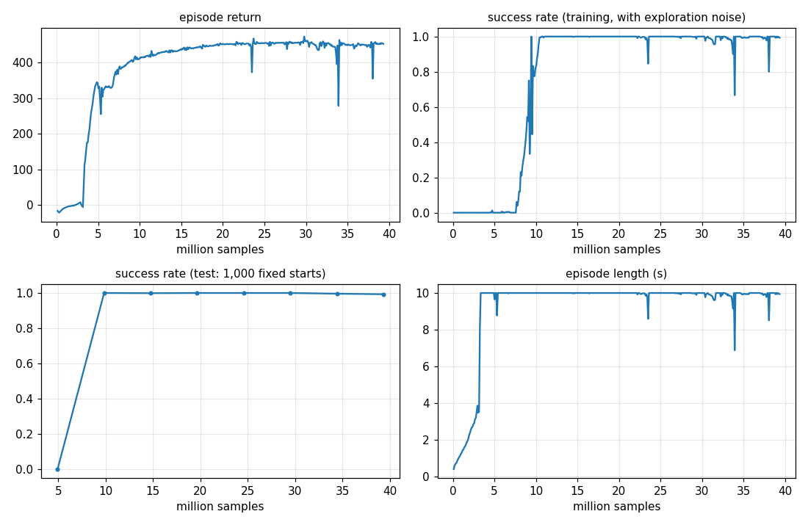

# Level 1: Hover

**Goal:** a neural network learns to hold a drone still at 1 m, starting from a messy random start.
Nobody tells it how. It only gets a score (the reward) and figures out the rest.

**Done when:** on 1,000 random starts it stays within 10 cm of the target for the last 5 s of a 10 s flight.

**Result:** 100.0 % success, 0 crashes, after about 10 million samples (≈ 2.5 minutes on the RTX 5090).

```
python -m mindflight.play --policy policies/hover.pt        # watch the trained drones
python -m mindflight.train --task hover --view              # train your own and watch it learn
python -m mindflight.evaluate policies/hover.pt             # the 1,000-start test
```



---

## The loop

Every 1/50 s:

| Step | What happens |
|---|---|
| 1. Look | The drone's **observation**: 22 numbers (below) |
| 2. Decide | The **policy** network turns them into 4 motor commands |
| 3. Fly | The physics runs 10 steps of 2 ms |
| 4. Score | The **reward** says how good that was |

4,096 drones do this at the same time on the GPU. Each lives in its own world.

## What the drone sees (the observation)

| Numbers | What |
|---|---|
| 3 | velocity (m/s) |
| 9 | rotation matrix: which way is up, forward, left |
| 3 | spin rate (rad/s) |
| 4 | the last motor commands |
| 3 | where the target is, from here (m) |

Why a rotation matrix and not a quaternion? `q` and `−q` are the same rotation.
A network would see two different inputs for the same thing. The matrix has no such trap.

## What the drone does (the action)

4 numbers between −1 and 1, one per motor:

```
motor RPM = hover RPM × (1 + 0.5 × action)
```

| action | RPM | thrust |
|---|---|---|
| 0 | hover | exactly holds the weight |
| +1 | 1.5 × hover | 2.25 × weight (full throttle) |
| −1 | 0.5 × hover | 0.25 × weight |

## The reward (the score)

Per step:

| Part | Points | Why |
|---|---|---|
| alive | +1 | staying up is good |
| distance | −1 per metre (max −1) | be at the target |
| tilt | −0.2 × (1 − cos tilt) | stay level |
| spin | −0.02 × spin² | don't spin |
| twitch | −0.1 × change in action² | smooth motors |
| crash | −5, episode ends | floor, upside down, too far, spinning too fast |

The distance part is capped so the reward never goes below 0.
If it could, crashing early would be the best way to stop losing points!

## The two networks

| Network | In | Out | Job |
|---|---|---|---|
| **Policy** (actor) | observation | 4 motor commands (a mean and a spread) | decide |
| **Value** (critic) | observation | one number | guess the future score from here |

Each is 3 layers of 256, 256, 128 neurons.

While learning, actions are drawn at random around the mean (the spread).
That randomness is how it **explores**: it tries things a little different from what it knows.
When we test or show off, we use the mean only.

## PPO in 5 lines

1. Fly every drone for 24 steps with the current policy. Write everything down.
2. **Advantage:** for each action, "did things go better or worse than the value network expected?"
3. Make better-than-expected actions more likely, worse ones less likely.
4. **But only a little.** If the new policy would change an action's chance by more than 20 %, stop pushing.
   That is the **clip**. It stops one lucky batch from wrecking the policy.
5. Teach the value network to guess better. Repeat.

One round of this is an **iteration**: about 98,000 samples, about 1.2 s.

### Advantage, a bit more

The value network guesses `V(s)`: "from here I'll score about this much".
After one step we know a bit more: the reward `r` we got, and the guess for the next state.

```
surprise  δ = r + γ · V(next) − V(now)
```

Positive surprise: the action was better than expected. **GAE** adds up the next few surprises,
fading each by γλ (0.99 × 0.95) per step, so it looks a little way ahead, not just one step.

`γ = 0.99` is the **discount**: a point 1 s (50 steps) away is worth 0.99⁵⁰ ≈ 0.6 points now.

### Two kinds of "episode over"

| How it ended | What PPO assumes about the future |
|---|---|
| **crashed** | nothing more to come: future = 0 |
| **out of time** | it was fine and would have kept scoring: future = V(last state) |

Mixing these up teaches the drone that the 10 s mark is a cliff.

## What we tuned

| Change | Why |
|---|---|
| Start spread 0.2 (not 0.5) | The Crazyflie is tiny and twitchy. With 0.5 random noise it flipped in 0.4 s and could barely learn |
| Adaptive learning rate | It speeds up or slows down to keep each update's change near a target (KL 0.01) |
| Observation scaling | Each input is rescaled to mean 0, spread 1 (more in Level 2) |

## What the tests prove

| Test file | Checks |
|---|---|
| `test_envs.py` | shapes; starts are in range; perfect hover scores 1 per step and stays put; reward drops with distance, tilt and spin; crashes end the episode with −5 and reset; timeouts are *not* crashes; the action wiring keeps the motor signs |
| `test_ppo.py` | GAE matches a hand calculation and stops at a crash; observation scaling matches the true mean and spread; PPO learns a simple game |
| `test_policy_viewer.py` | the viewer flies policies in real time, draws the targets, and sends charts once |
