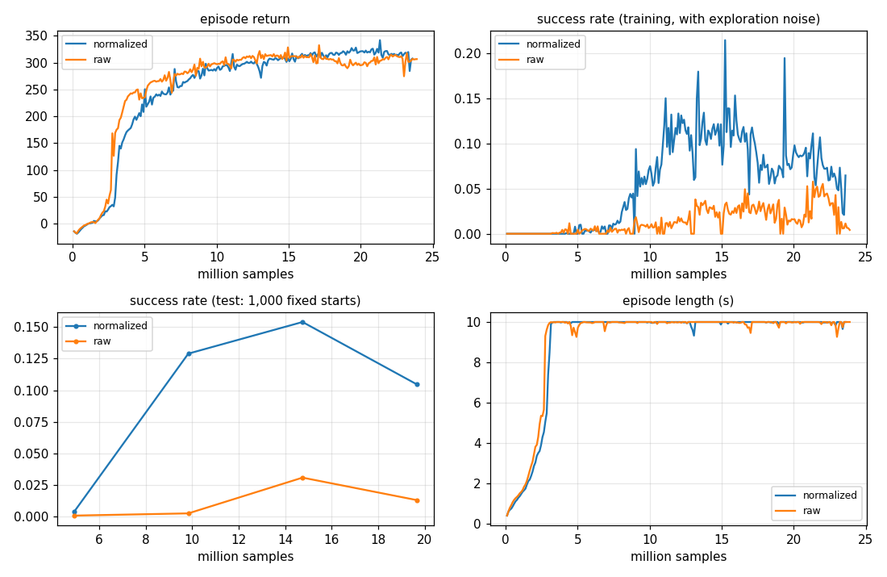

# Level 2: Fly to a point

**Goal:** fly to a random target, stop there, then do it again. A new target comes every 2.5 s, anywhere in a
3 × 3 × 1.5 m box. That is 4 targets per 10 s flight.

**Done when:** at least 95 % of targets are reached: within 10 cm, and still there for the last 0.5 s.

**Result:** **99.3 %** of 4,000 targets reached (99.2 % on 8,000 more), no crashes. It started from the Level 1
hover brain, which already knew how to fly toward a point, so it learned in a few minutes.

```
python -m mindflight.play --policy policies/waypoint.pt       # watch: yellow dots are the targets
python -m mindflight.train --task waypoint --view             # train it yourself
python -m mindflight.evaluate policies/waypoint.pt            # 1,000 test flights = 4,000 targets
```

---

## What changed from hover

| | Hover | Fly to a point |
|---|---|---|
| target | fixed, 1 m up | new random one every 2.5 s |
| alive | +1 a step | +2 a step |
| distance in the reward | −1 per metre, up to 1 m | −0.5 per metre, up to 4 m (targets can be 4 m apart) |
| near the target | – | +0.5 · (1 − d / 30 cm) inside 30 cm, and +0.5 inside 10 cm |
| crash if | > 3 m from the target | outside the 6 × 6 × 3.5 m arena |

The observation is the same 22 numbers. The last 3 ("where is the target from here") now jump every 2.5 s.

## The lesson: observation normalization

The policy sees numbers of very different sizes:

| Observation | Typical size |
|---|---|
| target distance | up to 3 m |
| velocity | up to a few m/s |
| rotation matrix | between −1 and 1 |
| spin | up to 10+ rad/s |
| last action | between −1 and 1 |

A neural network multiplies each input by a weight and adds them up.
A big input shouts. A small one whispers. The network has to learn very different weights just to hear them
equally, and one learning rate can't suit them all.

**Normalization** fixes that before the network sees anything:

```
normalized = (x − running mean) / running spread         then clipped to ±5
```

The mean and spread are measured from everything the drones have seen so far, and keep updating.
After that, every input is "about 0, give or take 1".

### The experiment

Two runs, the same in every way except one switch (`--set normalize_obs=false`):



This run is from scratch, with an earlier version of the reward (it doesn't reach 95 % in 24 M samples, but
both runs got the same reward, so the comparison is fair).

- **Without normalization the drones learned to *survive* a little faster** (episode return, top left).
  Surviving is coarse: stay upright, don't fall.
- **But they never got *precise*.** Test success (bottom left) peaked at 3 % without normalization against
  15 % with it, about 5 × better. Hitting a 10 cm target needs the small numbers (a few cm of error, a slight
  tilt) to be heard. Unscaled, the loud inputs drown them out.

## Getting the reward right (the real work in this level)

The reward took four tries. Each fix came from measuring *why* targets were missed, not from guessing:

| Try | What we saw | Fix |
|---|---|---|
| 1 | hovered ~7 cm off target: reward stayed high, success slid from 91 % to 55 % | bonus for being inside 10 cm, so the reward and the test want the same thing |
| 2 | targets 3+ m away reached 32 % of the time (99 % under 2 m) | the distance penalty stopped at 2 m, so the first metre of a long trip earned nothing: count out to 4 m |
| 3 | halving the slope to keep the reward ≥ 0 made it lazy: 1.5–2.5 m targets fell from 89 % to 67 % | keep the slope, raise the alive bonus to 2 instead |
| 4 | the value loss spiked on a regular beat and success swung 70 ↔ 95 % | **all 4,096 drones got new targets on the same step**. Start each drone at a random point of its episode (staggered starts) |

The last one is worth remembering: with thousands of copies of the same world, *synchronized* copies make the
data lopsided. Stagger them.

Two more things that mattered:

- **Start from what it knows.** The shipped policy starts from `hover.pt` (`--init policies/hover.pt`). From
  scratch, even 40 M samples reached only ~1 % success: getting precise from nothing is slow.
- **Let it explore again.** A finished policy's action spread has shrunk to almost nothing (0.05). Resetting it to
  0.15 (`--reset-std 0.15`) gave it room to find better moves: 99 % against ~80 % without the reset.

## Tests

| Test | Checks |
|---|---|
| `test_waypoint_targets_change_every_2_5_s_and_count_when_settled` | new targets on time; a target only counts when the drone settled on it |
| `test_waypoint_leaving_the_arena_is_a_crash` | the arena walls |
| `test_running_norm_matches_all_data_at_once` (Level 1) | the running mean and spread are exact |
