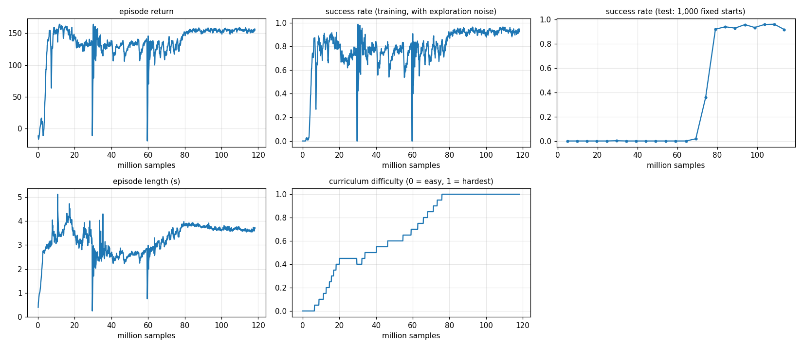

# Level 3: Gates

**Goal:** fly through 6 square gates, in order, without touching them. Every flight is a new random course.

**Done when:** at least 90 % of flights finish all 6 gates on the hardest courses.

**Result:** RESULT_LINE

```
python -m mindflight.play --policy policies/gates.pt          # 8 drones fly the same course; a new one every 20 s
python -m mindflight.train --task gates --view                # train it and watch the curriculum climb
python -m mindflight.evaluate policies/gates.pt               # 1,000 courses at the hardest setting
```

Gate colours in the viewer: **green** = someone's next gate, **orange** = later, **grey** = everyone is through.

---

## The course

| | Easiest (difficulty 0) | Hardest (difficulty 1) |
|---|---|---|
| opening | 1.0 m square | 0.5 m square |
| turn between gates | 0° (a straight line) | up to ±60° |
| climb or drop between gates | 0 | up to ±0.5 m |
| distance between gates | 1.5–2.5 m | 1.5–2.5 m |

The Crazyflie is 12 cm across (with props), so at 0.5 m it has about 19 cm to spare on each side.

## Passing a gate

Each gate has a **normal**: the direction you're meant to fly through it.
Every step we check which side of the gate's plane the drone is on:

```
side = (position − gate centre) · normal          negative = before the gate, positive = after
```

When `side` flips from − to +, the drone crossed the plane. Where? We draw a straight line between where it was
and where it is, and find where that line meets the plane. Then:

| Crossed... | Result |
|---|---|
| inside the opening (6 cm margin for the drone's size) | ✅ passed, on to the next gate |
| on the frame (up to 10 cm outside the opening) | 💥 crash |
| wide of the gate | nothing: missed it, go back and try again |

## What the drone sees (11 extra numbers)

| Numbers | What |
|---|---|
| 3 | next gate centre, from here (m) |
| 2 | next gate's facing (cos, sin) |
| 3 + 2 | the gate after that, the same way |
| 1 | opening size (m) |

Seeing *two* gates ahead lets it plan the turn before it gets there, like a real racing pilot.

## Reward

| Part | Points |
|---|---|
| progress | +10 per metre closer to the next gate |
| each gate | +10 (+10 more for the last one) |
| spin, twitch | small minus |
| crash | −5, flight over |

No tilt penalty here: a fast drone has to lean hard to turn.

## The lesson: curriculum learning

Starting on the hardest courses, a beginner drone hits the first frame almost every time.
Nearly every try fails the same way, so there is almost nothing to learn from.

So we start easy and make it harder **only when it's ready**:

```
smoothed success = 0.8 × old + 0.2 × this iteration's success
if smoothed success > 80 %:  difficulty += 0.05   (up to 1)
```



CURRICULUM_FINDINGS

## Tests

| Test | Checks |
|---|---|
| `test_gates_course_shapes_and_obs` | course shape, opening at the hardest setting, gate spacing |
| `test_gate_passed_through_the_middle` | a clean pass moves on and pays the bonus |
| `test_gate_frame_hit_is_a_crash_and_a_wide_miss_is_not` | the frame is solid, the air around it is not |
| `test_all_gates_in_order_finishes` | the course ends after gate 6 |
| `test_curriculum_climbs_when_success_is_high` | difficulty climbs; a fixed difficulty stays fixed |
