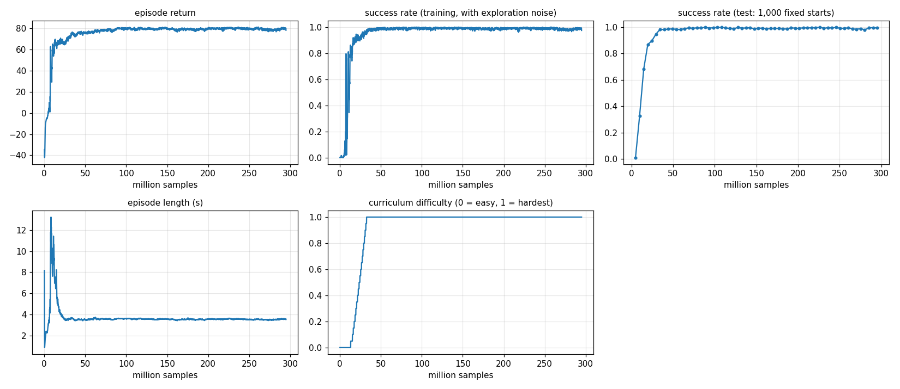

# Level 4: Obstacles

**Goal:** cross a field of pillars to a goal 7 m away, without touching any. The drone is *not* told where the
pillars are. It only has a fake lidar: 48 distance sensors in a ring.

**Done when:** at least 90 % of flights reach the goal without touching a pillar, in the densest fields.

**Result:** **100.0 %** of 1,000 densest fields crossed (99.6 % on 2,000 more), about 3.6 s per crossing
(≈ 2 m/s). It passed the 90 % mark at 98.3 % after ~350 iterations; the shipped policy trained on to 3,000.

```
python -m mindflight.play --policy policies/obstacles.pt      # 4 drones, each in its own pillar field
python -m mindflight.train --task obstacles --view
python -m mindflight.evaluate policies/obstacles.pt
```

---

## The arena (from above)

```
  y = +3 m  ───────────── wall ─────────────
              ·    ○    ·    ○
   start      ○    ·    ○    ·       goal
   x = −3.5   ·    ○    ○    ○       x = +3.5
              ○    ·    ○    ·
  y = −3 m  ───────────── wall ─────────────
```

- Pillars stand on a 4 × 5 grid, 1.2 m apart in x and 1 m in y. Each one is moved up to 15 cm at random,
  and is 8–20 cm thick. A grid (not pure randomness) makes sure a path always exists.
- Pillars go floor to ceiling: you can't fly over them.
- Touching a pillar, a wall, the floor or the 3 m ceiling is a crash.

## The lesson: sensors and raycasting

### The lidar

48 rays, one every 7.5°, turning with the drone (ray 0 points where the nose points). Each ray reports the
distance to the first pillar or wall it hits, up to 3 m.

The policy gets **closeness** = 1 − distance / 3 m: 0 = nothing near, 1 = touching. "Nothing there" is then a calm 0.

### Raycasting a pillar

Seen from above a pillar is a circle (centre **c**, radius r). A ray starts at **o** and goes along **u**:
points on it are **o** + t·**u**. It touches the circle where

```
|o + t·u − c|² = r²
```

Write **w** = **c** − **o**, b = **u**·**w**, k = |**w**|² − r². That becomes t² − 2bt + k = 0, so

```
t = b − √(b² − k)
```

| Case | Meaning |
|---|---|
| b² < k | the ray's line misses the circle |
| t < 0 | the circle is behind the ray |
| k < 0 | the drone is inside the circle: distance 0 |
| otherwise | hit at distance t |

We do this for every drone × ray × pillar at once (4,096 × 48 × 20 = 3.9 million tests) in one GPU step.
Walls are easier: a ray going toward +y meets y = 3 at t = (3 − o_y) / u_y.

## Reward and curriculum

| Part | Points |
|---|---|
| progress | +10 per metre closer to the goal, counted up to 2 m/s |
| goal (within 20 cm) | +20, flight over |
| crash | −30, flight over |
| spin, twitch | small minus |

Each grid spot has a pillar with chance 0.3 + 0.6 × difficulty: about 6 pillars when easy, 18 when hardest.
Difficulty climbs like in Level 3 (smoothed success above 80 % → +0.05).



### Two things we got wrong first (and how we found them)

We counted *why* drones crashed (2,000 test flights at the hardest setting):

| Version | Pillar crashes | Reached the goal | Speed |
|---|---|---|---|
| 16 rays, progress paid at any speed | 1,261 | 698 | ~2.7 m/s |
| **48 rays, progress paid up to 2 m/s** | **40** | **1,960** | ~1.5 m/s |

1. **Too few rays.** 16 rays are 22.5° apart. At 1 m the gap between two rays is 39 cm, wider than a thin pillar
   (16 cm). Many pillars were simply invisible until too late. 48 rays (7.5°) close the gap to 16 cm at 1.2 m.
2. **Speed always paid.** Progress was paid per metre, so going faster always earned more. It learned to blast
   across. Capping the paid speed at 2 m/s takes away the reason to rush, so slowing near pillars is free.
   (And, as in Level 3, the crash cost went up to −30.)

## Tests

| Test | Checks |
|---|---|
| `test_known_hit_and_miss` | hit distance = centre − radius; misses and "behind" report the max range |
| `test_glancing_hit_and_nearest_of_two` | an off-centre hit uses the formula; the nearest pillar wins |
| `test_empty_spots_and_inside_a_pillar` | empty grid spots are invisible; inside a pillar reads 0 |
| `test_walls` | wall distances up, down, and parallel |
| `test_obstacles_env_lidar_sees_a_pillar_in_front` | ray 0 points along the nose; touching is detected |
