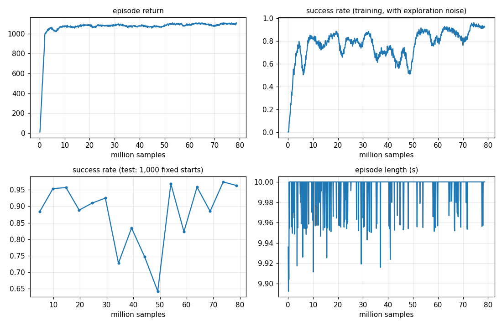

# Level 5: Sturdy

**Goal:** fly to points (Level 2) on a drone that is never quite the same twice, in gusty wind.

**Done when:** with random mass (±20 %) and gusts, at least 95 % of flights survive and keep tracking targets,
and a policy trained *without* the randomness does measurably worse.

**Result:** **97.4 %** of targets reached in gusty wind on random drones, **0 crashes**. The same task flown by
the Level 2 policy (trained in still air on one perfect drone): 84.6 %.

```
python -m mindflight.play --policy policies/sturdy.pt          # 36 drones, each its own weight and wind
python -m mindflight.train --task sturdy --init policies/waypoint.pt --reset-std 0.15
python -m mindflight.evaluate policies/waypoint.pt policies/sturdy.pt --task sturdy
python -m mindflight.evaluate policies/waypoint.pt policies/sturdy.pt --task sturdy --env gust_scale=2   # stress test
```

---

## New physics (`mindflight/physics/aero.py`)

Until now the drones flew in a vacuum. Level 5 adds air.

| Effect | Formula | Size for the Crazyflie |
|---|---|---|
| **Rotor drag** | F = −(Σ ω_i) · diag(k_xy, k_xy, k_z) · v_air (body frame) | 5.6 mN per m/s at hover: a 3 m/s gust pushes with ~6 % of the weight |
| **Wind** | v_air = v − wind | enters only through drag |
| **Ground effect** | extra thrust = thrust · c_ge · (r_prop / 4h)² | +27 % right at the floor, +3.8 % at 10 cm, gone above 70 cm |

ω_i = prop speed in rad/s. The coefficients are the same published Crazyflie numbers as before (cf2x.urdf).

These are switched on per drone through a `DroneVariation`. With no variation, `step` gives exactly the old
answer (a test checks it). The GPU stepper records them into its CUDA graph too, with buffers for wind and
the scales, so the wind can change every step without re-recording.

## The lesson: domain randomization

A policy trained on one perfect drone in still air learns *that* drone. Change anything and it is lost.
Real drones are never exactly the published numbers: batteries sag, props chip, the air moves.

So we train on **thousands of slightly different drones in all sorts of wind**:

| Each episode, at random | Range |
|---|---|
| mass (inertia scales with it) | ±20 % |
| prop strength | ±10 % |
| motor lag | 0.7 × to 1.5 × |
| steady wind | 0–2 m/s, any direction |
| gusts | change every step (below) |

The policy is **not told** any of this. It has to notice from how it moves ("I'm drifting left, push right").

### Gusts

Each gust direction does a random walk that is pulled back toward zero (an Ornstein–Uhlenbeck process):

```
gust ← gust − gust · dt / τ + σ · √(2 · dt / τ) · noise          τ = 0.5 s,  σ = 1.5 m/s sideways, 0.5 up/down
```

`τ` is how long a gust lasts; `σ` is how strong they typically are. Wind = steady + gust, often 1–4 m/s.

## The experiment

Two policies, the same 1,000 test flights (4,000 targets) in three kinds of weather:

| Policy | Calm air, standard drone | Training-strength wind, random drones | **Twice** that wind |
|---|---|---|---|
| `waypoint.pt` (Level 2: one perfect drone, still air) | 99.3 % | 84.6 % | 56.0 % |
| `sturdy.pt` (Level 5: randomized) | **99.8 %** | **97.4 %** | **77.8 %** |

- In calm air they are equal: being trained for rough weather cost nothing.
- In the wind it was trained for, the randomized policy misses 1 target in 40 instead of 1 in 6.
- In wind *twice as strong as anything it ever saw*, it still does much better. It didn't memorize the wind; it
  learned to correct for being pushed.
- Neither one crashes (≤ 0.3 %). The wind doesn't knock them down; it pushes them off target.

The sturdy policy started from `waypoint.pt` (`--init`, spread reset to 0.15) and trained for 800 iterations.



## Tests

| Test | Checks |
|---|---|
| `test_neutral_variation_changes_nothing` | scales of 1 and no wind = the old physics |
| `test_heavier_drone_sinks_at_hover_rpm` | 20 % heavier sinks at exactly g · (1 − 1/1.2) |
| `test_weaker_props_sink_and_stronger_ones_climb` | thrust scale |
| `test_laggier_motors_spin_up_slower` | motor time constant scale |
| `test_wind_blows_the_drone_downwind_and_it_tends_to_wind_speed` | wind works through drag, and only through drag |
| `test_ground_effect_lifts_a_drone_near_the_floor_only` | ground effect near the floor, none at 1.5 m |
| `test_graph_stepper_with_variation_matches_eager_and_takes_new_values` | the GPU fast path gives the same answer with new wind every call |
| `test_sturdy_randomizes_drones_and_wind_and_gusts_move` | the randomization ranges |
