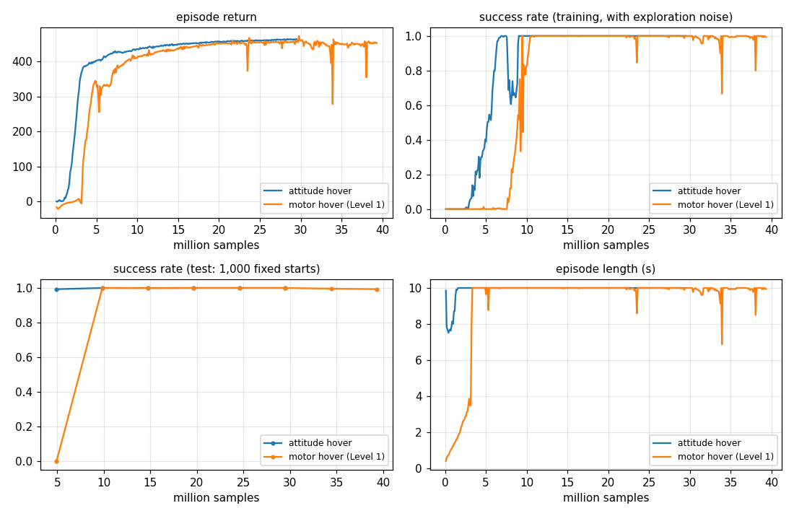

# Phase 2 · P2: the onboard controller

**Why:** a real Crazyflie doesn't let the PC set motor speeds. The PC sends a **setpoint** over the radio:
thrust, roll angle, pitch angle and yaw rate. The drone's own firmware holds that attitude 500 times a second.
So a brain that will one day fly the real drone has to learn to send setpoints, through a controller like
the one on the drone.

```
brain (50 Hz) ──thrust, roll, pitch, yaw rate──▶ onboard controller (500 Hz) ──motor speeds──▶ physics
```

**Result:**

| Brain | Test (1,000 flights) | Fresh test (2,000) |
|---|---|---|
| `policies/hover_attitude.pt` | 100.0 % | 100.0 % |
| `policies/waypoint_attitude.pt` | 97.0 % | 96.9 % |

```
python -m mindflight.train --task hover --env action_mode=attitude --view
python -m mindflight.play --policy policies/waypoint_attitude.pt
```

## The controller (`mindflight/physics/controller.py`)

Two loops inside each other, like the Crazyflie's default controller, then mixing:

| Step | Asks | Answer |
|---|---|---|
| 1. angle loop | how far from the roll/pitch I was asked for? | wanted turn rate = 10 × angle error |
| 2. rate loop | how far is the gyro from that turn rate? | wanted spin-up = 25 × rate error + 20 × its running total |
| 3. mixing | which 4 motor thrusts give this thrust and these torques? | invert the motor table |

The "running total" (the integral) is the controller's memory. It cancels steady pushes, like wind or a battery
that sits off-centre.

How fast it is: a 20° roll is reached in **0.16 s** with 2 % overshoot, close to a real Crazyflie.

| Action number | Means | Range |
|---|---|---|
| 0 | thrust | weight × (1 + 1.25 a): from 0 to full (2.25 × weight) |
| 1 | roll | ± 30° |
| 2 | pitch | ± 30° |
| 3 | yaw rate | ± 180 °/s |

The ±30° tilt limit is a safety limit, like the one on the real drone. It is why waypoint lands at 97 %
instead of the raw-motor brain's 99.3 %: very long trips take a little longer.

## Learning is faster



Hover reached 99 % in about **5 M samples** in attitude mode, against about 10 M with raw motors. The controller
already does the hard, fast part (balancing). The brain only has to decide where to lean.

## Honest limits

- The gains are ours, in physical units, chosen for a similar response. They are **not** the firmware's numbers,
  which are in PWM units. The real drone will feel a bit different; Phase 2 · P3 (randomization) is how the
  brain learns to cope with that.
- The deploy step (P4) still has to convert our setpoint to the firmware's units: degrees, deg/s, and a thrust
  number from 10001 to 60000.

## Tests (`tests/test_controller.py`)

| Test | Checks |
|---|---|
| mixing gives back the thrust and torques asked for | the inverse is exact |
| mixing signs match the motor table | +roll speeds up the left motors, +pitch the back, +yaw the clockwise ones |
| roll/pitch steps settle in < 0.3 s, < 20 % overshoot | response speed |
| yaw rate is tracked | within 5 % |
| commands move the drone the right way | roll right → −y, nose down → +x, more thrust → up |
| zero action hovers | no drift |
| GPU graph path matches the CPU loop | the fast path is the same physics |
