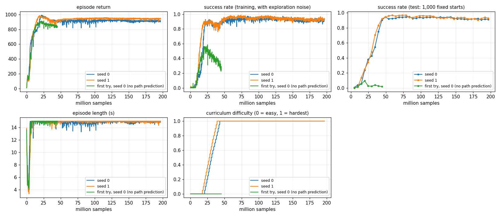

# Phase 2 · P7: intercept thrown balls

**Goal:** a person stands still. Someone throws soft foam balls at them. The drone guards the person and touches
each ball before it gets there, without ever coming closer than 0.5 m to the person.

**Done when:** at least 80 % of throws are intercepted at the speeds below, and the drone comes within 0.5 m of the
person in at most 1 % of episodes.

**Result:** `policies/intercept.pt` catches **93.7 %** of throws (94.0 % on 2,000 fresh episodes), with **0.5 %**
of episodes ending too close to the person (0.4 % fresh). Tested on the hardest setting: throwers anywhere in
±45°, balls thrown at 8–15 m/s, with realistic sensing (Lighthouse) and a slightly different drone every episode.
With perfect sensing: 95.9 % and 0 %. The 0.5 m rule only holds for throws like the ones it trained on: read
"A brain only knows the throws it trained on" below before any real test.

```
python -m mindflight.play --policy policies/intercept.pt                       # watch it (4 people, 4 drones)
python -m mindflight.train --task intercept --env sensors=lighthouse real_world=true
python scripts/intercept_report.py policies/intercept.pt --sweep              # score it at many throw speeds
python scripts/intercept_limits.py                                             # what physics allows at all
```

In the viewer: **blue** cylinder + head = the person, **pink ring** on the floor = the 0.5 m safety line,
**orange** dot = the ball, **light orange** line = where the ball is going, **green** flash = caught,
**red** flash = the ball hit the person, small grey dot = the guard point.

---

## The world

| Thing | Value |
|---|---|
| person | upright cylinder, 0.25 m radius, 1.8 m tall, at the origin, facing +x |
| guard point | 1.2 m in front of the person, 1.8 m up. The drone waits here |
| thrower | 6–10 m away, in an arc in front of the person |
| aimed at | the torso: 1.0–1.45 m up, up to 10 cm left or right |
| throws | every 2.5–3 s, about 5 per 15 s episode |
| caught | the drone's 6 cm sphere touches the ball (centres closer than 9.5 cm) |
| missed | the ball touches the person or the floor |
| safety | drone's edge closer than 0.5 m to the body = crash (−30). That is 0.81 m from the person's middle |

The guard point is 1.8 m up, not lower, because thrown balls come **down** onto the person. A ball thrown from 8 m
that takes 1 s is 1.7–2.3 m high when it passes 1.2 m in front of them.

## The ball

A soft foam ball: **25 g, 7 cm across** (radius 3.5 cm), drag coefficient 0.5. Gravity plus air drag:

```
drag force = ½ · air density · Cd · area · speed²       (against the motion)
```

Light foam balls slow down **a lot**. At 10 m/s, drag slows ours by 4.6 m/s², half of gravity. A tennis ball (57 g)
only slows by 2.0 m/s². So a foam ball arrives slower than it was thrown, which makes it easier to catch. Its top
falling speed is 14.6 m/s (a tennis ball's is 22 m/s).

| Flight time (6–10 m) | Thrown at | Speed near the guard point | Highest point |
|---|---|---|---|
| 0.9–1.1 s | 11.0 m/s (8.6–13.6) | 7.9 m/s | 2.7 m |
| 1.1–1.3 s | 10.2 m/s (8.5–12.2) | 7.1 m/s | 3.2 m |

A longer flight time is not a slower throw: it is a **higher lob**. From 6–10 m every throw leaves the hand at
8 m/s or more.

**How it is simulated** (`mindflight/envs/intercept.py`):

- The ball moves in steps of 2 ms, like the drone's physics. At 12 m/s it moves 2.4 cm per step, much less than
  the 9.5 cm touch distance, so a touch can't be skipped. (At the brain's 20 ms it would move 24 cm per step.)
- Each step uses Heun's method. Without drag this is the exact parabola (a test checks it).
- **Aiming** with drag has no simple formula. So we "shoot": throw, see where the ball is after T seconds, correct
  the throw by the miss, repeat. 10 rounds get within a millimetre.
- Aiming is slow, so the env keeps a **bank** of 4,096 aimed throws from straight ahead. Each throw is turned to a
  random direction when used. That is free because the person is round and there is no wind.

## What the drone sees

The ball comes from a pretend **camera tracker**: it is 20 or 40 ms late, and a little wrong. A real tracker
smooths its measurements, so its error changes slowly. We model that as an error that is fixed for each throw
(1.5 cm, 0.10 m/s) plus a small jitter every step (1.5 cm, 0.05 m/s).

| Numbers | What |
|---|---|
| 3 | ball − drone (as measured) |
| 3 | ball velocity (as measured) |
| 1 | ball in the air: 1 or 0 (all ball numbers are 0 when there is none) |
| 3 | **"go here"**: the nearest point of the tracker's predicted path that the drone may fly to |
| 1 | **"by then"**: seconds until the ball gets there |
| 3 | guard point − drone |
| 3 | person's chest − drone |
| 1 | distance to the person's body |

The predicted path is the true path plus the error the tracker's wrong start causes (position error + velocity
error × time ahead). A test checks this matches really flying the wrong start to within 2.5 cm, 0.8 s ahead.

## Reward

| Part | Points |
|---|---|
| alive | +1 every step (keeps the reward ≥ 0, so crashing never pays) |
| ball in the air | +10 per metre closer to the ball's path, +1 per step for sitting right on it (within 30 cm) |
| no ball | −0.2 per metre from the guard point |
| throw ends | +10 × (1 − closest the ball came / 0.5 m): near misses earn a little |
| caught | +20 |
| ball hits the person | −10 |
| crash (incl. too close) | −30, episode over |

"The ball's path" only counts where the drone may go: 0.3–3 m up, and only until the ball comes within 0.9 m of the
person's middle.

## Curriculum

Like the gates (Level 3): start easy, get harder each time the smoothed catch rate passes 80 %.

| | Difficulty 0 | Difficulty 1 (the test) |
|---|---|---|
| thrower's arc | ±10° | ±45° |
| flight time | 1.1–1.3 s | 0.8–1.4 s (fast throws and high lobs mixed) |
| thrown at | ~10 m/s | 8–15 m/s |

## Results

Each brain: 1,000 test episodes (about 5,000 throws) on fixed starts, the hardest setting (±45°, 0.8–1.4 s).
"Too close" = episodes that ended because the drone's edge came within 0.5 m of the body.

| Brain | Sensing | Caught | Too close | Other crashes |
|---|---|---|---|---|
| **seed 1 = `policies/intercept.pt`** | Lighthouse + real-world drones (as trained) | **93.7 %** | **0.5 %** | 0 % |
| seed 1, 2,000 fresh episodes | Lighthouse + real-world drones | 94.0 % | 0.4 % | 0 % |
| seed 1 | perfect | 95.9 % | 0 % | 0 % |
| seed 1 | Flow deck (not trained on it) | 75.7 % | 1.6 % | 0 % |
| seed 0 | Lighthouse + real-world drones | 91.5 % | 0.3 % | 0 % |
| seed 0, 2,000 fresh episodes | Lighthouse + real-world drones | 91.2 % | 0.8 % | 0.1 % |
| seed 0 | perfect | 95.5 % | 0 % | 0.1 % |
| seed 0 | Flow deck | 71.2 % | 2.3 % | 0 % |

Both seeds pass the bar (≥ 80 % caught, ≤ 1 % too close) with Lighthouse and with perfect sensing. Neither passes
with the Flow deck: its position is a few cm off and drifts, and the ball only has 9.5 cm to spare.

How it was trained (both seeds the same way):

| Stage | What | Iterations | Test at the end |
|---|---|---|---|
| 1 | from scratch, perfect sensing, curriculum to ±45° / 0.9–1.1 s | 2,000 (best at 800–850) | 95–97 % caught, 0.1–1 % too close |
| 2 | + Lighthouse sensing, real-world drones (`--init`, `--reset-std 0.15`) | 600 | about 93–94 % at the same throws, with the new sensing |
| 3 | + the wider throw mix 0.8–1.4 s (`--reset-std 0.1`) | 800 (best at 400) | the table above |

```
python -m mindflight.train --task intercept --iters 2000
python -m mindflight.train --task intercept --init <stage 1>/best.pt --reset-std 0.15 --env sensors=lighthouse real_world=true start_difficulty=1.0
python -m mindflight.train --task intercept --init <stage 2>/best.pt --reset-std 0.1 --env sensors=lighthouse real_world=true start_difficulty=1.0
```



Stage 1 for both seeds. The curriculum reached the top after about 40 M samples; the test score (at the hardest
setting) climbed with it to about 95 %. The green line is the version without the "go here" observation (lesson 3).

**Other throws** (`--sweep`, `policies/intercept.pt`, Lighthouse + real-world drones):

| Flight time | ±10° | ±30° | ±45° | ±60° | ±90° |
|---|---|---|---|---|---|
| 1.3–1.5 s (high lobs) | 96 % | 90 % | 86 % | 81 % (3.6 %) | 65 % (**30 %**) |
| 1.1–1.3 s | 99 % | 97 % | 95 % | 92 % (2.1 %) | 73 % (**20 %**) |
| 1.0–1.2 s | 99 % | 98 % | 96 % | 93 % (2.3 %) | 73 % (**23 %**) |
| 0.9–1.1 s | 99 % | 98 % | 96 % | 90 % (3.3 %) | 66 % (**28 %**) |
| 0.8–1.0 s | 98 % | 96 % | 92 % | 83 % (3.6 %) | 58 % (**33 %**) |
| 0.7–0.9 s (12–17 m/s) | 89 % | 83 % | 73 % | 62 % (3.0 %) | 38 % (**40 %**) |

Caught, with too-close episodes in brackets where they are over 1 %. Inside the trained ±45° arc, too close stays
at 0.1–0.4 %. **Outside it, the safety rule breaks**: 2–4 % at ±60°, 20–40 % at ±90°.

## Physics limits: what can a Crazyflie catch?

`scripts/intercept_limits.py` asks, for each throw: could a drone starting still at the guard point reach **any**
allowed point of the ball's path in time? No learning, just physics:

- reaction time 0.15 s (tracker delay + one brain step + tilting over)
- thrust at most **1.66 × weight**: the most the radio can ask the real Crazyflie for (its motors could do 2.25 ×)
- lean at most 30° (roll or pitch alone) or 41° (30° roll + 30° pitch, leaning diagonally)
- sideways that gives 5.7 m/s² at 30° and 8.7 m/s² at 41°; straight up only 0.66 g
- "touch": fly through the path at speed. "stop": get onto the path and stop, so the ball runs into you

At the hardest training setting (±45°, 0.8–1.4 s):

| Lean | Touch at speed | Stop on the path |
|---|---|---|
| 30° | 100 % reachable | 89 % reachable |
| 41° (diagonal) | 100 % | 98 % |

So the 93.7 % brain is close to what physics allows. Stop on the path, 30° lean, % of throws reachable:

| Flight time (±0.1 s) | ±10° | ±20° | ±30° | ±45° | ±60° | ±90° |
|---|---|---|---|---|---|---|
| 1.4 s | 100 | 100 | 100 | 100 | 100 | 100 |
| 1.2 s | 100 | 100 | 100 | 100 | 98 | 79 |
| 1.0 s | 100 | 100 | 100 | 92 | 72 | 48 |
| 0.9 s | 100 | 100 | 94 | 71 | 55 | 35 |
| 0.8 s | 100 | 94 | 77 | 51 | 38 | 26 |
| 0.6 s (15+ m/s) | 49 | 28 | 19 | 13 | 10 | 6 |

The same, leaning 41° diagonally:

| Flight time (±0.1 s) | ±10° | ±20° | ±30° | ±45° | ±60° | ±90° |
|---|---|---|---|---|---|---|
| 1.0 s | 100 | 100 | 100 | 100 | 97 | 75 |
| 0.9 s | 100 | 100 | 100 | 95 | 82 | 54 |
| 0.8 s | 100 | 98 | 92 | 73 | 57 | 39 |
| 0.6 s | 53 | 38 | 25 | 18 | 13 | 8 |

"Touch at speed" is easier: 100 % down to 0.9 s within ±60°, but at 0.6 s still only 30–44 % at ±45°. These are
estimates from a simple model: the trained brain catches 73 % of 0.7–0.9 s throws at ±45°, a little better than the
30° "stop" table says, because it leans diagonally and doesn't always stop.

What this means:

- **Throws of 1 s or longer from in front are physically easy.** Even stopping on the path, nearly 100 % are
  reachable within ±45°.
- **Fast throws (0.8 s and under) from the side are not.** At 0.6 s (15+ m/s) from ±45°, only 13–44 % can even be
  reached. No brain can fix that; it needs a faster drone or a bigger lean.
- Throws from **behind** the person (beyond ±90°) are out: the drone would have to go round the person.
- The 30° lean is a firmware setting, not a hardware limit. `--env max_tilt_deg=45` raises it in the sim (passed to
  the onboard controller). On the real drone it is a parameter too, but more lean means less height control, so
  test it carefully first.

## Lessons

**1. Look at the throws before you design the reward.** The first version had "easy" throws of 1.5–1.7 s. Those are
4 m high lobs that drop steeply onto the person, about 2.5 m up where the drone was allowed to meet them. It also
pulled the drone back to the guard point hard (−0.4 per metre). It caught 0 % after 10 M samples and stayed home.
We changed three things at once: easy throws of 1.1–1.3 s, the guard point up to 1.8 m, and a gentler pull (−0.2).
Then it learned. (Because they changed together, we can't say which mattered most.)

**2. Near misses should earn a little.** A catch is all or nothing within 9.5 cm. We added a small reward for how
close the ball came, so 15 cm is better than 40 cm. On its own it did not fix lesson 3.

**3. Measure WHY it misses.** The second version caught up to 55–85 % and then got worse again, in both seeds,
while the reward told it to catch. We measured the misses: the ball passed **15 cm above** a drone that was waiting
almost still. The brain had to work out the ball's future path in its head from one noisy, late reading, and its
guess slowly drifted. The fix was not a new reward: it was a better **observation**. The tracker now tells the
brain "go here, by then". With that, both seeds passed 90 % and kept it (green line in the chart = the old version).

**4. A brain only knows the throws it trained on.** The stage 1 brain trained on 0.9–1.1 s throws. It caught 97 %
of those. Then we tested high lobs (1.3–1.5 s): it caught only 38–56 %, and worse, it **chased them into the safety
zone**: 5–10 % of episodes too close at ±10°–45°, 49 % at ±90°. A missed catch is a failure; breaking the 0.5 m rule
is a danger. So stage 3 trains on a mix of 0.8–1.4 s, and lobs became 86–96 % caught with 0.1–0.4 % too close.
It is still true outside ±45° (table above). **On real hardware, the deploy runner must enforce the 0.5 m rule
itself** (a geofence around the person), not trust the brain.

**5. Realistic sensing matters (P3's lesson again).** The stage 1 brain (perfect sensing) tested with Lighthouse
sensing and real-world drones: 63 % caught and **17 % too close**. With the Flow deck: 32 % and 33 %. After stage 2
(trained with Lighthouse sensing and real-world drones): 93 %+ and under 1 %.

## SAFETY: before anything real

Throwing things at a flying drone near a person can hurt someone. Go step by step, and never skip a step.

| Step | Where | What |
|---|---|---|
| 1 | simulator | this page. The policy must pass the test here first |
| 2 | empty room | drone + balls, **no person**. A tall stand or a box marks where the person would be |
| 3 | empty room, a dummy | a dummy (cardboard, foam) as the person. Check the 0.5 m rule really holds |
| 4 | person behind a barrier | a real person **behind a net or clear screen**, only after many safe runs in step 3 |

Rules for every real test:

- **Soft foam balls only** (20–60 g). Never hard balls, never tennis balls.
- **Prop guards** on the drone, always.
- **A net** between the drone's area and the person. The drone can be knocked by a ball and fall or fly off.
- **Never throw at faces**. Aim at the torso, under the shoulders. Nobody throws while someone is still setting up.
- **Kill switch** in a second person's hand, always (`python -m mindflight.deploy` has one, see `docs/phase2-deploy.md`).
- The drone must be **tracked** (Lighthouse or motion capture) for the 0.5 m rule to mean anything. With the Flow
  deck its position is too rough (see the results).
- Start with **slow, underhand throws** from straight in front. Wider and faster only when the slow ones are boring.
- Eye protection for everyone in the room.

## Honest limits

- **A real hit knocks the drone.** A 25 g ball at 8 m/s carries as much push as the 27 g drone moving at 7 m/s.
  The sim removes the ball on touch and doesn't push the drone. A real drone will be thrown off course, maybe
  out of the air. That is why prop guards and the net are on the list.
- The **tracker** is a model: a fixed error per throw plus jitter, and a prediction made from the true path. A real
  ball tracker (cameras + a filter) has to be built and measured. Its real numbers should replace ours.
- Throws are perfect: every ball is aimed exactly at the torso. Spin, wind and wobbly throws are not modelled.
- The brain has no memory: it sees one reading at a time.

## Tests (`tests/test_intercept.py`)

| Test | Checks |
|---|---|
| without drag the ball flies the exact parabola | the integrator is exact for gravity alone |
| drag alone matches the exact solution | x(t) = ln(1 + k·v₀·t) / k, within 0.5 mm |
| drag slows the ball and shortens the throw | more than 1 m shorter after 1 s; energy only goes down |
| aimed throws arrive on target | within 2 mm, at the chosen time |
| unblocked throws hit the person | every throw, on the body (not the floor) |
| throws come from the arc at the set flight time | arc, distance, flight times |
| a drone on the path intercepts, one beside it does not | catch detection + bonus |
| too close to the person is a crash | 0.45 m crashes, 0.55 m doesn't; also above the head |
| waiting at the guard point pays; reward ≥ 0 when idle | reward shape |
| tracker is late, and zero without a ball | 1- and 2-step delay |
| tracker error model matches flying from the wrong start | the "go here" prediction |
| tracker points at the path without noise | "go here" is on the true path, nearest point |
| curriculum climbs, throws get harder | difficulty, arc, flight time; fixed difficulty stays |
| tilt limit option reaches the controller | `max_tilt_deg` |
| episode info counts throws | throws, hits, success |
| viewer scene shows person, ball and path | the viewer's shapes |
