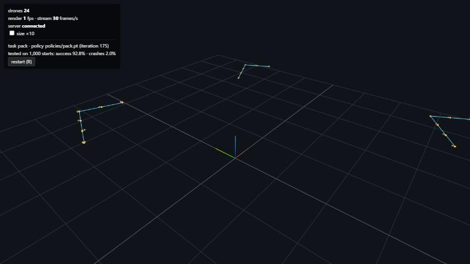

# Phase 2 · P5: packs (many drones, one sky)

**Goal:** groups of 6 drones fly in formation to waypoints. They share the air: they can crash into each other,
and a drone above pushes the one below down (downwash). One brain flies every drone. Nobody is in charge.

**Done when:** packs of 6 reach ≥ 90 % of formation waypoints with < 2 % collisions, downwash on.

**Result** (`policies/pack.pt`, 1,000 packs = 6,000 drones per test, fixed seeds, downwash on, attitude mode):

| Test | Waypoints reached | Drones that collided | Packs with a collision |
|---|---|---|---|
| seed 1 | **94.5 %** | **1.8 %** | 5.4 % |
| seed 2 | **95.4 %** | **1.3 %** | 3.8 % |

Both pass the "done when" if a collision is counted per drone. Counted per pack (did *any* of the 6 crash?) it is
4–5 %, not under 2 %. See "Open problems".

```
python -m mindflight.play --policy policies/pack.pt                      # 4 packs of 6 (cyan lines = formation)
python -m mindflight.evaluate policies/pack.pt --n 6000 --seed 1         # 1,000 packs
python -m mindflight.train --task pack --init runs/pack/widened.pt       # train your own (see "How it was trained")
```



---

## The task (`mindflight/envs/pack.py`)

| Thing | Rule |
|---|---|
| worlds | drone i lives in world i // 6. Drones in a world share the sky. Worlds never meet. |
| formation | hexagon, line or V, neighbours 0.7 m apart |
| waypoints | every 3 s the formation moves 0.5–2 m, turns up to ±90°, and half the time changes shape |
| slots | fixed: drone k always takes slot k. Slots are numbered right to left in every shape. |
| start | drones on a "launch pad" (random spots 0.8 m apart, two layers), in slot order from right to left. The first formation is right there. |
| collision | two centres closer than 12 cm (2 × collision radius), checked along the path flown in the last 20 ms. Both crash. |
| a crash | the whole pack starts over. The crashed drones get −30; their pack-mates are "cut short" (not blamed). |
| success | a waypoint counts when **all 6** drones were within 15 cm of their slots for the last 0.5 s |
| episode | 12 s = 4 waypoints |

## What each drone sees (50 numbers)

| Numbers | What |
|---|---|
| 19 | the usual: velocity, rotation, spin, last action |
| 3 | my slot − my position |
| 3 × 6 | my 3 nearest pack-mates, nearest first: where they are and how they move, relative to me |
| 1 | distance to the nearest pack-mate |
| 3 × 3 | where those 3 are heading (their slot − their position) |

All of it is worked out per pack as 6 × 6 tables, for all 683 packs at once (no Python loops).

## The reward

| Part | Points per step |
|---|---|
| alive | +3 |
| distance to my slot | −0.5 per metre (up to 4 m) |
| near my slot | +0.5 inside 30 cm (more the closer), +0.5 inside 15 cm |
| crowding | up to −1: a pack-mate closer than 50 cm, or closing in fast within 1 m |
| tilt, spin, twitch | small, as in hover |
| crash | −30, once |

Alive is 3 (waypoint had 2) so the reward never goes below 0. Otherwise crashing would pay.

## Physics: downwash, cheaply

`physics/aero.py -> downwash_grouped` works on a (packs, 6, 3) table: only the 36 pairs inside each pack.
For 4,098 drones that is 25 thousand pairs instead of 17 million for the old all-pairs `downwash_world`.
`DroneVariation.group_size = 6` switches it on, and the CUDA-graph stepper records it like the other flags.
A test checks the grouped and all-pairs versions give the same forces.

## What went wrong first, and how we found it

Every fix came from measuring *why* waypoints were missed (a script that sorts crashes by kind and time, and
misses by shape and waypoint), not from guessing.

| Try | What we measured | Fix |
|---|---|---|
| 1 | The waypoint brain, given 31 extra inputs with zero weights, already reached 72 % of waypoints. But 27 % of packs had a collision. Training 250 iterations: no better. **97 % of collisions came in the first 0.75 s**, head-on at 2.4 m/s. | – |
| 2 | The first waypoint was a different place from the start: some drones had 5 m to fly *and* had to cross. First waypoint 60 %, later ones 97 %. | the first formation forms where the pack starts |
| 3 | Too little practice at crossing: it happens once per 12 s. | the pack changes shape at half the waypoints; a "closing in" penalty warns earlier than "too close" |
| 4 | Line formations: only 76 %. Tracing one drone showed the **drones at the ends of a line wobbled** 15 cm. Their far pack-mates (3.5 m away, all on one side) are big, odd inputs. Hiding the 2 furthest gave the *same* brain 32 % more line waypoints. | see only the 3 nearest (k = 3) |
| 5 | Shape changes: slots were numbered round the hexagon, so hexagon -> line sent drones straight through each other (about 3.5 % of packs collided per waypoint). | number slots right to left in every shape: about 0.7 % |
| 6 | Start: drones got random spots, so on average half of them had to cross. 8.8 % of packs collided while forming up. | put drones on the pad in slot order: 1.9 % |
| 7 | Training after that: the waypoint score swung between 75 % and 97 % from one snapshot to the next, with the same few collisions. Misses were one drone sitting just at 15 cm: a steady offset of a few cm. | pick the snapshot on a fixed-seed test (seed 9), report on two other seeds |

Tries 5 and 6 changed the *task*, not the brain, and they did the most. The lesson: **make the problem easy where
you honestly can** (number the slots sensibly, set the drones down in order), then let the neighbours handle the rest.

Two ideas that did **not** help, measured:
- "Both drones run the same brain, so maybe they dodge the same way and hit." Then exploration noise would break the
  tie and help. It didn't: noisy actions gave the same collisions (7.2 % vs 7.5 % of drones).
- Seeing where pack-mates are heading (their goal) did not measurably help in a 200-iteration test. It is kept:
  real drones can share it over the same radio, and it costs 9 inputs.

## Downwash: a surprise

| Test (seed 1) | Waypoints | Drones collided |
|---|---|---|
| downwash on (trained this way) | 94.5 % | 1.8 % |
| downwash off | 91.1 % | 3.1 % |

Turning downwash **off** gives *more* collisions. We saw the same with the untrained waypoint brain (26 % of packs
collided with downwash, 47 % without). When one drone passes over another, the wash pushes the lower drone down,
out of the way. In this model downwash is a narrow column (a few cm wide 0.4–0.9 m below), so it mostly matters
when drones pass right over each other. Drones spent only 0.4 % of their time pushed by more than 5 % of their weight.

## Stress tests (seed 1, not trained for)

| Test | Waypoints | Drones collided |
|---|---|---|
| shipped setting | 94.5 % | 1.8 % |
| scattered start (random order on the pad) | 85.3 % | 4.1 % |
| Lighthouse sensor noise and delay | 43.9 % | 1.5 % |

With noisy sensors the pack still doesn't crash, but it can't hold 15 cm: it never trained with them.

## How it was trained

| Step | Iterations | Notes |
|---|---|---|
| `scripts/widen_policy.py policies/waypoint_attitude.pt --task pack` | – | the waypoint brain + zero weights for the new inputs |
| tries 1–4 above | 250 + 200 + 700 | `--init` from the step before each time |
| `widen_policy.py --columns "0:40,52,53:62"` | – | keep the 3 nearest pack-mates' columns (k = 5 -> 3) |
| ordered start | 100 | |
| merged main (thrust cap 1.66 × weight) | 175 | `--set learning_rate=0.0001 target_kl=0.005` -> `policies/pack.pt` |

About 1,400 iterations (140 M samples), on a GPU shared with other jobs.

**Widening a brain.** A network's first layer is `h = W · x + b`. Give W new columns of zeros for new inputs and the
brain flies exactly as before, while learning can still grow those weights. `--columns` can also drop inputs:
a dropped input acts like one that always shows its average.

## Open problems

- **Per-pack collisions are 4–5 %.** Most come in the first second, forming up, at 2–3 m/s closing speed. The brain
  rushes to its slot. Ideas: a speed limit near pack-mates, a curriculum that starts with slow formation changes.
- **Precision drifts between snapshots** (one drone at ~15 cm). A tighter inside-bonus radius might help.
- **No sensor noise yet.** Packs + P3 sensors is the next step before real hardware.
- Collision = two spheres of 6 cm. Real props can touch at a bit more than that.

## Tests (`tests/test_pack.py`)

| Test | Checks |
|---|---|
| shapes, world grouping, rounding | 50 numbers; drone i in world i // 6; 1,000 drones -> 1,002 |
| formation shapes | centred; drawn links are 0.7 m; slots numbered right to left |
| neighbour observation | a hand-made pack: mates sorted by distance, relative position, velocity and goal correct |
| collision | 10 cm apart crashes both and restarts only that pack; mates are cut short, not blamed |
| swept collision | two drones that swap places in one step are caught; side by side at 20 cm is fine; other worlds never collide |
| reward ≥ 0 | 4 m from the slot and fully crowded: still ≥ 0 |
| crowding | closing in costs; flying side by side doesn't |
| success | a waypoint counts only when all 6 settled; one drone 20 cm off fails it |
| grouped downwash | equals the all-pairs version; same in `step`; CUDA graph equals plain steps (GPU) |
| real_world + sensors | the pack env still works with P3's options |
| viewer | one grid spot per pack, slots and formation lines drawn |


## Realistic sensors and drones (follow-up #46)

`policies/real_pack.pt` started from `pack.pt` and trained 500 more iterations with `sensors=lighthouse real_world=true`
(noisy, late estimates and randomized drones, docs/phase2-sensors.md). 1,000 packs of 6, downwash on, realistic conditions:

| Brain | Formation waypoints | Drones collided | Packs with a collision |
|---|---|---|---|
| `pack.pt` (perfect data) | 13.8 % | 3.5 % | 10.6 % |
| **`real_pack.pt`** | **93.9 %** (seeds 1 and 2) | 1.7–1.9 % | 5.2–5.6 % |

The perfect-data pack brain falls apart with real sensors, the same story as P3. Still open: getting pack collisions
under 2 %.


## Smart slot assignment: collisions from 4.7 % to 0.5 % (follow-up #46)

We counted *when* packs collided: 63 % in the first second after takeoff, the rest 0.5–1 s after a formation
change. Both are moments when drones fly to new slots, and with **fixed slots** (drone k always takes slot k)
some paths cross.

The fix comes from real drone swarms. Every time the formation changes, give each drone the slot that makes the
pack's total **squared** travel distance smallest. With 6 drones there are only 6! = 720 ways to hand out the slots,
so the env tries them all at once on the GPU (`assignment="best"`, now the default).

Why squared? If two straight paths crossed, swapping those two drones' slots would always make the squared total
smaller. So the best assignment never has crossing paths.

Same brain (`real_pack.pt`), no retraining, 1,000 packs of 6, realistic sensors and drones:

| Slots | Formation waypoints | Packs with a collision |
|---|---|---|
| fixed | 95.3 % | 4.7 % |
| **best assignment** | **99.0 %** (98.8 % on seed 2) | **0.5 %** (0.6 %) |
| best, Flow deck (20 cm) | 93.6 % | 0.5 % |
| best, `pack.pt` with perfect sensors | 99.0 % | 0.0 % |

`real_pack.pt` is the realistic pack brain fine-tuned with a bigger cost for hitting a pack-mate
(`collision_penalty=80`, `crowding_weight=2`); that alone only got packs from 5.4 % to 4.7 %.

**Lesson:** the biggest win wasn't a better brain, it was a better plan for the brains to follow. On real drones the
assignment runs on the PC (or one leader drone) and each drone gets its slot over the radio.
